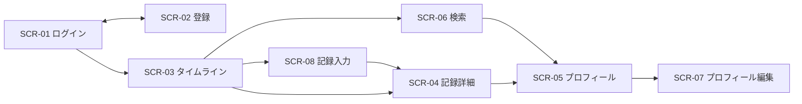

# 7. 画面設計

> 壁打ち用の草案。未承認・未実装・独立レビュー未実施。数値・方式は提案であり、実行結果ではない。

### 7.1 画面一覧
| ID | 画面 | 主な操作 |
|---|---|---|
| SCR-01 | ログイン | メール・パスワード、登録への導線 |
| SCR-02 | 新規登録 | username・表示名・メール・パスワード |
| SCR-03 | タイムライン | 全体／フォロー中、記録作成、いいね、詳細 |
| SCR-04 | 記録詳細 | 種目・各セット・写真・コメント、本人編集削除 |
| SCR-05 | プロフィール | 紹介、フォロー数、フォロー操作、記録一覧 |
| SCR-06 | ユーザー検索 | 部分一致検索、プロフィール、フォロー |
| SCR-07 | プロフィール編集 | 表示名、自己紹介、画像の変更 |
| SCR-08 | 記録入力・編集 | 実施日、種目、重量・回数、セットの追加削除、メモ、画像 |

### 7.2 画面遷移図

### 7.3 各画面の共通状態
取得中、0件、通信失敗、認証失効、入力エラーを分ける。保存中は二重送信を抑止するが、API側の権限・制約でも検証する。失敗時は入力を維持し、成功を先に表示しない。

### 7.4 記録の入力体験
初期値は今日、種目1個、セット1個。セット行は重量kg・回数で構成。種目とセットの追加・削除を可能にする。トレーニングの実施日と投稿日時は別に表示する。自重種目は重量0kgを許容する案。

### 7.5 UIモック
[操作モック](../mock/README.md)では8画面と記録・交流の疑似操作を確認できる。localStorageでブラウザ内に保存し、複数利用者を切り替える。確認済み操作と本実装との差はモックのREADMEに記録する。
