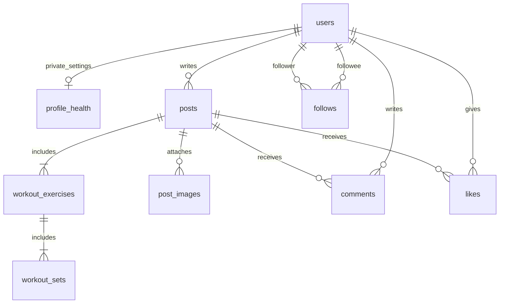

# 8. ER図

> User・認証試行窓・Djangoセッション・FL-03身体情報は実装対象。投稿・画像・交流のテーブルは後続の草案。検証と独立レビューの結果は別途記録する。

### 8.1 テーブル一覧
ユーザー、Djangoセッション、投稿、投稿内種目、セット、投稿画像、コメント、いいね、フォロー。全記録が会員間公開なので、初版に投稿別visibility列は設けない。

### 8.2 ER図

### 8.3 テーブル定義
| テーブル | 主な列 | 制約・索引 |
|---|---|---|
| users | id, username, email, password, display_name, bio, avatar_key, created_at | username/emailは正規化して一意。emailはプロフィール応答に出さない |
| profile_health | user_id, height_cm, weight_kg, age, formula, activity, height/weight/age/formula/activity/bmr/tdee/intake_public | UserへのOneToOne/CASCADE、全公開フラグfalse既定、数値範囲・enumのCHECK。GETでは行を作らず初回本人PUTで作成 |
| auth_rate_limits | key_hash, window_start, count | (key_hash,window_start)一意、認証試行を原子的に加算。期限切れ削除 |
| storage_cleanup_jobs | id, storage_key, operation_id, attempts, next_attempt_at | 削除対象キーの再試行、成功で完了。画像本体・署名URLは保持しない |
| django_session | session_key, session_data, expire_date | Django標準。期限切れ削除を運用に含める |
| posts | id, user_id, performed_on, note, created_at, updated_at | user_id外部キー、タイムライン用(created_at,id)索引 |
| workout_exercises | id, post_id, name, position | (post_id,position)一意 |
| workout_sets | id, exercise_id, position, weight_kg, reps | (exercise_id,position)一意、重量はdecimal、reps正整数 |
| post_images | id, post_id, storage_key, content_type, byte_size | post_id一意（初版1枚案）、storage_key一意 |
| comments | id, post_id, user_id, body, created_at, updated_at | 両外部キー、(post_id,created_at,id)索引 |
| likes | post_id, user_id, created_at | (post_id,user_id)一意 |
| follows | follower_id, followee_id, created_at | 組合せ一意、自己フォロー禁止CHECK |

### 8.4 制約
投稿削除で種目・セット・画像メタ・コメント・いいねを削除する。S3オブジェクトはDBのCASCADEでは削除できないため、削除対象キーを同じDBトランザクションでcleanup記録に残し、commit後に削除する。失敗は再試行する。詳細は[API共通契約](api/README.md)を参照。
投稿の作成・更新は原子的に行い、途中の不正セットで一部保存されない。投稿は1〜10種目、各種目1〜20セット、重量0〜999.99kg、回数1〜999、種目名1〜80文字、メモ500文字以内を仮制約とする。日付は実施日で、未来日を拒否する案。整数・小数・日付の境界を受け入れ条件で検証する。

FL-03実装の身体情報テーブルはaccounts_profilehealth。身長・体重はdecimal(4,1)、年齢0〜120、計算結果は保存せず現在の入力から算出。Userのbioと同じtransactionで更新する。投稿・画像・交流の図は後続実装の草案。
