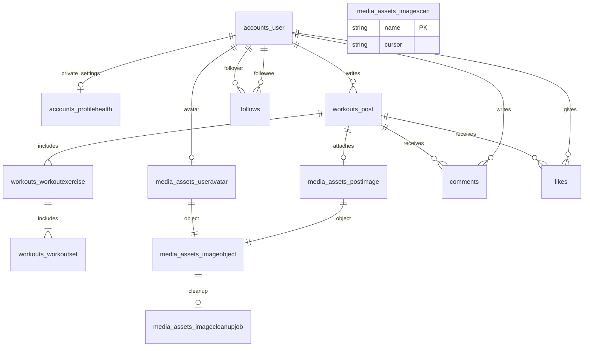

# 8. ER図

> User・認証試行窓・Djangoセッション・FL-03身体情報・FL-04投稿/種目/セット/使用済みIDは実装対象。FL-05画像も実装対象。交流テーブルは後続の草案。検証と独立レビューの結果は別途記録する。

### 8.1 テーブル一覧
ユーザー、Djangoセッション、投稿、投稿内種目、セット、投稿画像、コメント、いいね、フォロー。記録本文・セット・消費カロリーは会員間公開。FL-04では運動時間・種類にminutes_public/kind_publicの個別公開列を設ける。

### 8.2 ER図

### 8.3 テーブル定義
| テーブル | 主な列 | 制約・索引 |
|---|---|---|
| accounts_user | id, username, email, password, display_name, bio, date_joined | username/emailは正規化して一意。emailはプロフィール応答に出さない |
| accounts_profilehealth | user_id, height_cm, weight_kg, age, formula, activity, height/weight/age/formula/activity/bmr/tdee/intake_public | UserへのOneToOne/CASCADE、全公開フラグfalse既定、数値範囲・enumのCHECK。GETでは行を作らず初回本人PUTで作成 |
| accounts_authratelimit | ip_digest, window_start, count | (ip_digest,window_start)一意、認証試行を原子的に加算。期限切れ削除 |
| django_session | session_key, session_data, expire_date | Django標準。期限切れ削除を運用に含める |
| workouts_postidentity | id, author_id | UUID主キー。削除済みIDも保持し再利用を拒否。author削除時SET_NULL |
| workouts_post | id, user_id, performed_on, note, minutes, kind, minutes_public, kind_public, energy_kcal, energy_method, created_at, updated_at | idはIdentityへのOneToOne/PROTECT、user_id外部キー、(user_id,created_at DESC,id DESC)・(created_at DESC,id DESC)索引。公開フラグはfalse既定 |
| workouts_workoutexercise | id, post_id, name, position | (post_id,position)一意 |
| workouts_workoutset | id, exercise_id, position, weight_kg, reps | (exercise_id,position)一意、重量はdecimal、reps正整数 |
| media_assets_imageobject | id, actor, target_kind, target_uuid, key, backend, digest, size, content_type, width, height, state, created_at, written_at, retired_at | UUID主キー、key一意、pending/attached/retired。操作IDは再利用しない |
| media_assets_postimage | id, post_id, object_id | Post OneToOne/CASCADE、ImageObject OneToOne/PROTECT |
| media_assets_useravatar | id, user_id, object_id | User OneToOne/CASCADE、ImageObject OneToOne/PROTECT |
| media_assets_imagecleanupjob | id, object_id, attempts, next_attempt_at, completed_at | ImageObject OneToOne/PROTECT、退役後も再試行情報を保持 |
| media_assets_imagescan | name, cursor | backend別の巡回checkpoint |
| comments | id, post_id, user_id, body, created_at, updated_at | 両外部キー、(post_id,created_at,id)索引 |
| likes | post_id, user_id, created_at | (post_id,user_id)一意 |
| follows | follower_id, followee_id, created_at | 組合せ一意、自己フォロー禁止CHECK |

### 8.4 制約
FL-04は投稿削除で種目・セットを削除し、使用済みIDを保持する。FL-05は添付行のCASCADE時にもImageObjectを退役させ、同じDBトランザクションでcleanup jobを残し、commit後に物理画像の削除を試みる。画像Objectとjobは残して失敗や遅延書込みを再回収する。交流のCASCADEは後続案。詳細は[API共通契約](api/README.md)を参照。
投稿の作成・更新は原子的に行い、途中の不正セットで一部保存されない。投稿は1〜10種目、各種目1〜20セット、重量0〜999.99kg、回数1〜999、種目名1〜80文字、メモ500文字以内とする。日付は実施日で、日本時間の未来日を拒否する。整数・小数・日付の境界を受け入れ条件で検証する。

FL-03実装の身体情報テーブルはaccounts_profilehealth。身長・体重はdecimal(4,1)、年齢0〜120、計算結果は保存せず現在の入力から算出。Userのbioと同じtransactionで更新する。FL-04の投稿・種目・セット・使用済みIDは8.1節の実テーブルに対応する。画像の図はFL-05実装、交流は後続実装の草案。

### FL-04 実装

workouts_postidentity（UUID主キー、author nullable SET_NULL）は使用済みIDの台帳としてPost削除後も残す。workouts_postはidentityへのOneToOne主キー（PROTECT）、user CASCADE、performed_on/note/created_at/updated_at、nullable minutes/kind、minutes_public/kind_public既定false、nullable energy_kcal/energy_method。workouts_workoutexerciseはpost CASCADE・name/position、workouts_workoutsetはexercise CASCADE・position/weight_kg Decimal(5,2)/reps。それぞれ親とpositionが一意、重量0..999.99・回数1..999のCHECK制約。Postには(user_id,created_at DESC,id DESC)と(created_at DESC,id DESC)の索引を作る。上の画像テーブルはFL-05実装、交流テーブルは後続草案。User削除の画面は今回の対象外。

### FL-05 実装

- media_assets_imageobject: client operation UUID主キー、actor UUID/target_kind/target_uuid、immutable random key一意、backend=local、digest/size/content_type/dimensions、pending/attached/retiredと各timestamp。key/idは再利用せず、画像bytes/署名URL/filenameはDB非保存。
- media_assets_postimage: Post OneToOne/CASCADE、ImageObject OneToOne/PROTECT。1記録1画像。
- media_assets_useravatar: User OneToOne/CASCADE、ImageObject OneToOne/PROTECT。1ユーザー1avatar。
- media_assets_imagecleanupjob: ImageObject OneToOne/PROTECT、attempts/next_attempt_at/completed_at。target削除後も残す。
- media_assets_imagescan: backend別の管理prefix巡回checkpoint。

添付切替・退役・cleanup記録は同一transaction、物理保存と別に確定する。画像APIはPost.updated_at/created_at/energyと身体情報を更新しない。cascadeのpre_deleteでも退役とjobを残し、commit後に清掃を試みる。途中rollbackでは旧添付と旧fileを保持する。
