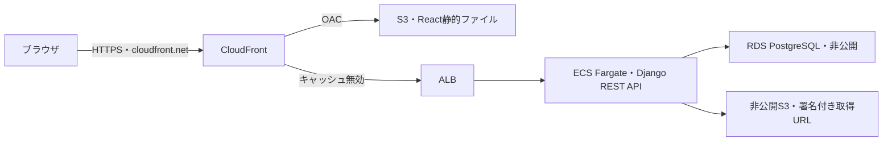

# 11. インフラ構成

> 壁打ち用の草案。未承認・未実装・独立レビュー未実施。数値・方式は提案であり、実行結果ではない。

### 11.1 構成方針
開発・通常検証はローカル。AWSは公開デモ・撮影に必要な期間だけ起動する。無料枠・クレジットを費用成立の前提にしない。東京リージョンを候補とし、実apply前に価格・リージョン・稼働時間で見積もる。

公開URLはユーザー回答によりMyTimelineと同じCloudFront提供ドメインを使用する。`https://<distribution>.cloudfront.net` と `cloudfront_default_certificate = true` の組合せでブラウザとのHTTPSを提供する。独自ドメイン、Route 53 hosted zone、独自ドメイン用ACM証明書を追加しない。再構築でURLが変わるため、Terraform outputからアプリ設定と動作確認に渡す。

主要サービスはCloudFront/S3＋ALB＋ECS Fargate＋RDS PostgreSQL＋画像S3を提案する。MyTimelineと同じ役割分担を保ち、NATなし案を推奨案として設計レビューに出す。

| 案 | 外向き通信 | 費用・検証事項 |
|---|---|---|
| 低費用案 | Fargateをpublic subnetに置きpublic IP＋Internet Gatewayを使用。NAT Gatewayなし | タスク用IPv4課金は残る。APIポートへの受信はALBのSGからだけ許可し、public IPへの直接到達を拒否することを検証 |
| MyTimeline同等案 | Fargateをprivate subnetに置きNAT Gatewayを使用 | NATの時間・処理量課金が増える。短期稼働時間を含めて比較 |

両案ともRDSはprivate subnet・非公開・Single-AZを基本案とし、FargateのSGからだけ接続できるようにする。Fargateは通常1タスク、ローリング配置時の一時2タスクも費用に含める。常設NAT・マネージドDBを不要と決めつけず、短期デモ全体の費用と学習範囲で判断する。

### 11.2 アーキテクチャ構成図

ブラウザ→CloudFrontのHTTPSと、CloudFront→ALBの通信は別の区間。MyTimelineは後者をHTTPとし、CloudFrontの送信元制限と専用ヘッダで直接アクセスを制限している。FitLogもpublic ALBのHTTP originを推奨案とする。ALB受信元はCloudFront origin-facingのmanaged prefix listに限定し、専用ヘッダの一致を転送条件とする。全区間TLSではない点を明示して設計レビューに出す。VPC origin＋internal ALBなら公開ALB用IPv4を減らせるが、origin依存・作成削除順・利用可能AZの追加確認が必要になるため、初版の推奨案から外す。

`/api/*` は共有キャッシュを無効にし、Cookie、CSRFヘッダ、クエリを必要な範囲で転送する。SPA用のフォールバックをAPIの401/403/404へ適用しない。Djangoが信頼するホストとHTTPS判定のヘッダはTerraformの実URL・固定したプロキシ経路に限定する。

### 11.3 コンポーネント一覧
すべてFitLog専用の名前・タグ・Terraform stateで識別する。共有ドメイン・IAM主体・既存VPC等を誤って削除しない。初版は単一環境・デモデータのみ、常時運転や冗長構成は不要。

### 11.4 ローカル開発での画像ストレージ
S3互換ストレージをComposeで起動する。AWS本体との互換性は撮影前のスモーク確認で補完する。ローカル成功だけでS3・IAMを検証済みにしない。

### 11.5 デプロイ順序と互換性
依存lock→ローカル検証→成果物build→Terraform plan/apply→成果物配置→migration→再実行可能なデモseed→readiness→ブラウザ操作の順。配置失敗とインフラ作成成功を区別する。DB互換性のある前版にのみ戻す。
構築とデプロイは別工程として実装する。`apply`が成功しただけでアプリ稼働完了とはしない。デプロイの入口・引数は構成決定後に定義する。

### 11.6 destroy と再構築
1. デモアカウント2名で認証・記録・画像・交流の操作を撮影する。
2. 動画と必要な検証記録をAWS外へ保存し、再生して確認する。
3. FitLog専用の破棄対象と削除されるDB・画像・ログを表示する。
4. Terraform destroyを実施し、失敗時はstateを残して同じ環境から再実行する。
5. stateに管理対象が残らないことと、リソース一覧で課金対象が残らないことを別々に検証する。
6. 再apply・再配置・migration・seed・基本操作を実行し、再現性を確認した後、再び破棄する。

| 対象 | 方針 |
|---|---|
| DB・デモ画像 | デモ専用として破棄。外部へ残したい情報は事前に明示的に保存 |
| S3 | オブジェクト・版・未完了multipartを含める。専用バケットに限り削除可能な設計 |
| EC2/EBS/EIP・ALB/NAT・ECS/RDS | 採用したリソースと付帯資源を全て管理・確認 |
| ECR・CloudWatch Logs・snapshot | 作成した場合は中身・自動生成分も管理し、不要な課金を残さない |
| state | ローカルで秘密情報として保持。Gitに入れず、削除失敗時に捨てない |
| 動画・ソース・設計・lock | ローカル／GitHub側に残し、AWS破棄の対象外 |

「すぐdestroyできる」は手順の準備と再実行性を意味し、AWSの削除処理時間が0分である保証ではない。削除開始から終了まで測定する。費用画面は反映遅延があるためリソース消滅確認と後日の請求確認を区別する。

### 11.7 将来検討事項
常設公開、バックアップ、Multi-AZ、管理認証、メール送信はデモの次段階。今回、実AWS操作は行っていない。

### 11.8 費用見積りの条件
24時間常設の月額だけでなく、構築・撮影・削除待ちを含む8時間、再現確認を含む24時間、削除忘れの730時間で比較する。無料枠やクレジットは引かない。NAT、ALB/LCU、Fargate CPU/メモリ、public IPv4、RDS稼働・ストレージ、S3・転送、ECR、CloudWatchを採用構成に応じて計上する。主要リソースの試算は次節。実構築前に利用量を含む総額を再見積もりする。

参考：[MyTimelineのCloudFront定義](https://github.com/koma236/MyTimeline/blob/fd9f00b1eb8e7211a577babd72690c7848bbcff7/terraform/cloudfront.tf)、[AWSの既定証明書](https://docs.aws.amazon.com/AmazonCloudFront/latest/DeveloperGuide/DownloadDistValuesGeneral.html)、[Fargateのpublic subnet経由の通信](https://docs.aws.amazon.com/AmazonECS/latest/developerguide/networking-outbound.html)、[CloudFront VPC originの条件](https://docs.aws.amazon.com/AmazonCloudFront/latest/DeveloperGuide/private-content-vpc-origins.html)。

### 11.9 主要リソースの試算（USD・税別）
2026-10-27に公式価格表を取得。東京、Linux/x86 Fargate 0.25vCPU/1GiB×1タスク、public ALB×1、RDS PostgreSQL db.t4g.micro Single-AZ＋gp3 20GiBを仮定。デモ負荷の実測でサイズを見直す。

| 項目 | 公式単価 | 試算/時 |
|---|---|---|
| Fargate CPU | $0.05056/vCPU時 | $0.01264 |
| Fargateメモリ | $0.00553/GiB時 | $0.00553 |
| RDSインスタンス | $0.025/時 | $0.025 |
| RDS gp3 | $0.138/GiB月×20、730時間換算 | $0.00378 |
| ALB | $0.0243/時 | $0.0243 |
| ALB LCU | $0.008/LCU時、1LCUを仮定 | $0.008 |
| public IPv4 | $0.005/IP時、ALB用2＋タスク用1を仮定 | $0.015 |
| 合計 | 稼働時間に応じた概算 | **$0.09425/時** |

8時間で約$0.75、24時間で約$2.26、730時間で約$68.80。総額上限ではない。S3・CloudFrontの通信とリクエスト、ECR、CloudWatch、DBバックアップ、RDS追加CPUクレジット、AZ間転送、配置中の追加タスク等は別途。FL-09開始前にデータ量・配信量を決めて加算する。時間単位切上げや削除待ちも実費に影響する。AWS Budgetsは通知であり課金停止の保証ではない。

出典：AWS公式Price List東京リージョン。公開日はECS 2026-10-19、RDS 2026-10-26、ELB 2026-09-11、VPC 2026-10-16。

- [AmazonECS価格JSON](https://pricing.us-east-1.amazonaws.com/offers/v1.0/aws/AmazonECS/current/ap-northeast-1/index.json)
- [AmazonRDS価格JSON](https://pricing.us-east-1.amazonaws.com/offers/v1.0/aws/AmazonRDS/current/ap-northeast-1/index.json)
- [AWSELB価格JSON](https://pricing.us-east-1.amazonaws.com/offers/v1.0/aws/AWSELB/current/ap-northeast-1/index.json)
- [AmazonVPC価格JSON](https://pricing.us-east-1.amazonaws.com/offers/v1.0/aws/AmazonVPC/current/ap-northeast-1/index.json)
